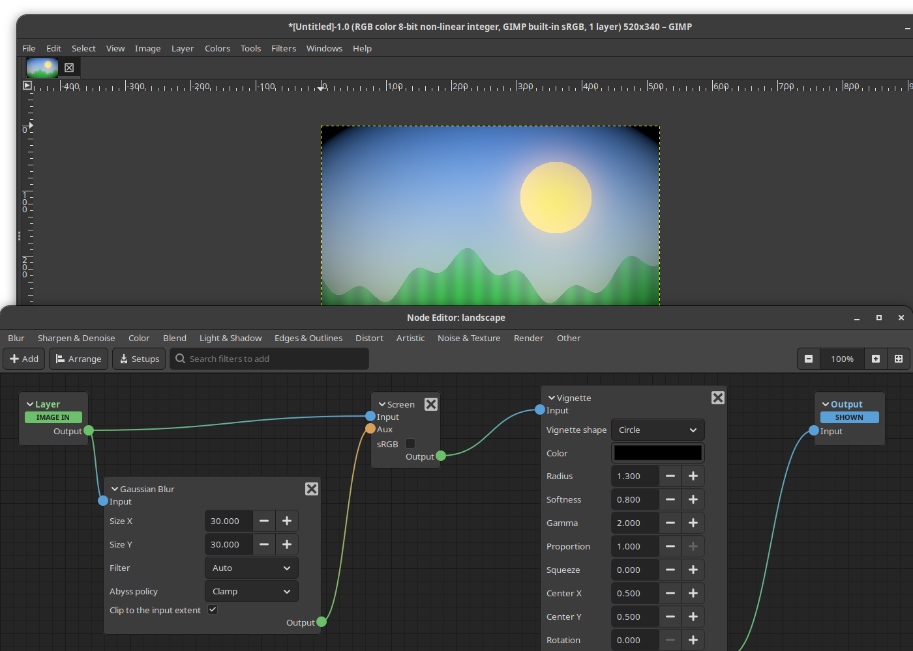

# Node Editor for GIMP

A node editor for GEGL in GIMP 3: put GEGL operations on a canvas as
nodes, link them as you like (branches, a result used twice, blend modes
with a second input), and see the result on the layer as you edit. The
graph is one non-destructive filter on the layer, **Node Graph**, that
stays editable: run the editor again on the layer to change it, also
after saving and opening the XCF.

*Filters > Generic > Node Editor...* The editor opens as its own window
(see "Docked like Blender" below).

To add a node: pick a filter from the menus along the top, click
**Add**, press **Shift+A** or right-click on the canvas (the node goes
where you clicked), or type in the search field and press Enter. Link
nodes by dragging from a green Output dot to an Input dot; the Output
node's input is what the layer shows. The Layer and Output nodes have a
bold title and a badge, and cannot be deleted. **Arrange** lays the
nodes out in columns from the layer to the output.

The menus put GEGL's categories together into about a dozen groups, as
GIMP's Filters menu does (Blur, Sharpen & Denoise, Color, Blend, ...),
with a heading for each category inside. Many third-party operations
have no category; they are placed by words in their titles ("bevel",
"glow", "noise"), and the rest go to Other. A group with fewer than three
filters goes into Other too.

**Selecting**: click a node to select it, Shift+click to add or take
one out, or drag a box on the empty canvas (with Shift to add to the
selection). Ctrl+A selects all, Escape none. Dragging a selected node
moves all the selected ones. Delete or X removes them (never
the Layer or Output node), Ctrl+D duplicates them with their values and
the links between them, and **Arrange** with two or more selected lays
out only those.

**Previews**: the eye in a node's title, next to its close button (or
Ctrl+Shift+click on the node), opens a small window with the image as it comes out of that node:
the layer's own pixels through the graph up to there, worked out at full
size (so radii and distances are the layer's) and scaled to fit, in
steps so that the editor stays responsive. It is worked out again after
each change; several can be open, and the canvas keeps showing the whole
graph.

**Undo** with Ctrl+Z (or the arrow buttons), redo with Ctrl+Shift+Z or
Ctrl+Y: every change to the graph, 50 steps back, quick changes of one
value as one step. **Clear All** (in the Setups menu) leaves only the
layer and the output, linked; one Ctrl+Z brings the whole graph back.
(GIMP's own undo sees only the filter changing.)

**Snap** (on by default) puts the frames of the nodes on the grid when
they are dragged, added from the menus or arranged.

**Zoom** with Ctrl+wheel, Ctrl+plus, Ctrl+minus and Ctrl+0, or the
buttons on the right; the last one shows all the nodes. Drag with the
middle button to move around the canvas. The canvas reaches a window's
size past the nodes on every side and grows as they move, so there is
always room, also above and to the left of the layer.

**Setups** saves the graph under a name, to use again on another layer:
**Insert** adds a saved setup at the end of the graph, between what fed
the output and the output; **Replace** shows it instead of the graph.
**Save Selection as Setup** saves only the selected nodes: what fed them
from outside comes from the setup's layer, and the node whose result went
on goes to its output. A
setup is a JSON file in `gegl-nodes/setups` in your GIMP profile folder
(`~/.config/GIMP/3.2/`); copy, share or keep them in git as you like.

## What is in here

- **`operations/node-graph.c`**: the GEGL operation `nodes:graph`
  (LGPL-3.0-or-later, written to be offered to GEGL). It runs a graph in
  GEGL's chain syntax, like `gegl:gegl`. GIMP refuses `gegl:gegl` as a
  layer filter ("The filter is unsafe") because a graph may hold an
  operation that writes files, which an XCF would then do when it is
  opened. `nodes:graph` builds each graph in a scratch graph first,
  never processed, and refuses it if any operation in it is a sink, is in
  the category input, output, programming, display, video or debug, has a
  file path or URI property, is a graph itself, or is `gegl:introspect`
  (it runs a program). It then shows the layer unchanged and says why in
  its `error` property. It also keeps the editor's node layout in a
  `layout` property, so that the layout is saved with the filter.
- **`plug-ins/gegl-nodes/`**: the GIMP plug-in (Python, GPL-3.0-or-later):
  - `gn_graph.py`: the graph as plain data (JSON), the GEGL graph made
    from it, and the string for the filter. The string is written here,
    with every linked input as `pad=[ ... ]` and a result used more than
    once named with `id=`/`ref=`: GEGL's own `gegl_serialize` writes only
    the `input` and `aux` pads, and would drop `aux2` (Remap), `aux1` to
    `aux16` (Piecewise Blend) and the exposures of Combine Exposures.
    Each operation's values are still written by GEGL, with colors put
    back exactly (GEGL keeps three decimals).
  - `gn_ops.py`: which operations are offered, with their input pads and
    editable properties, all from GEGL's introspection: every GEGL
    operation installed shows up, your own ones too.
  - `gn_editor.py`: the editor, made with
    [GtkNodes](https://github.com/aluntzer/gtknodes).
  - `gegl-nodes.py`: the plug-in: finds or makes the filter, opens the
    editor, and updates the filter 120 ms after each change.

## Install

Needs a native GIMP 3.2 with its GEGL development files (meson, ninja, a
compiler), and GtkNodes with GObject introspection. GtkNodes is not
packaged; build the `sandbranch` branch of
[sandbranch/gtknodes](https://github.com/sandbranch/gtknodes) next to
this repository, with its `dev/build-local.sh` (into `../gtknodes/_inst`).
That branch has the fixes the editor needs (below). Then:

    dev/install.sh             # nodes:graph and the plug-in, for you
    dev/install.sh --remove

and restart GIMP. Elsewhere, point `GEGL_NODES_GTKNODES` at the install
prefix of GtkNodes.

## Tests

    tests/run.sh               # all; GN_GUI=0 without the GIMP window test

208 checks, plus lint, the build and the isolation check: unit tests in plain GEGL (the graph, the catalog, what
`nodes:graph` refuses, and that every one of the 155 operations offered is
accepted by it), the editor widget on a Broadway display, nodes dragged with real
pointer events (XTest on Xvfb), headless GIMP
(the filter, changes, a graph that would write a file, an XCF saved and
opened again), and the editor in a real GIMP on Broadway, driven through
the editor's own calls, with the layer checked pixel by pixel against
plain GEGL after each change and a screenshot in
`tests/output/gui/live.png`. GIMP runs isolated from your own folders,
and the run fails if anything in them changed.

## Changes are incremental

When an edit changes only values (the same operations, linked the same
way), `nodes:graph` sets the new values on the nodes it already has,
instead of building the graph again; and every node in it keeps its
result (GEGL's cache policy "always"; by itself GEGL keeps it only for
some operations). So only the changed node and what follows it are
computed again. Measured on a 2000x2000 image, a brightness change after
a bilateral filter: 0.9 s when built anew, 0.01 s now. Adding, removing
or relinking a node builds the graph anew. The cached results use
memory, within GEGL's tile cache (in GIMP, its tile cache size); how
much in practice has not been measured yet.

## Fixes in GtkNodes

Found while making this, on their own branches in sandbranch/gtknodes,
for upstream:

- `fix/socket-handlers`: removing a node left its sockets' signal
  handlers pointing at the node; a socket that outlived it (Python holds
  a reference) then signalled into the freed node.
- `fix/child-y`: a node's `y` place was set from, and read back as, its
  `x`, so nodes ended up on the diagonal (also in
  `gtk_nodes_node_view_save` and `load`).
- `fix/icon-nullable`: `gtk_nodes_node_set_icon_name` takes `NULL` (no
  icon, no button), but its introspection data refused `None`. Without
  it, the Layer and Output nodes keep a delete button that does
  nothing.
- `fix/drag-root-coords`: a dragged node was moved by the pointer's
  offset within its own window, which moves only at the next layout, so
  until then each motion event added the whole offset again and the node
  ran away from the pointer (a 90 px drag moved it 522 px on a large
  canvas). It now goes to its place at the start of the drag plus how
  far the pointer has moved on the screen.
- `fix/size-request-in-allocate`: the view set its own size request at
  the end of laying out, which GTK 3 does not allow for; it now gives
  the extent of its nodes as its preferred size.
- `fix/scale-with-socket-radius`: a node's padding (10 px) and the room
  for its icon (25 px) were fixed, so nodes made smaller with their
  sockets (zoomed out) ran into each other.

The editor made the same mistake itself (it set the canvas size from
the scroll area's size-allocate signal): GTK then dropped every later
relayout of the canvas, so after a zoom the nodes kept sizes from
halfway and ran into each other, until the window was resized. It now
does that after the layout.

GtkNodes' child properties `x` and `y` are not a plain read either: they
copy the node's own `x` and `y` into GtkNodes' place for it, and read
halfway through a move (between setting `x` and `y`) they undid the
move's `y`. The editor reads the node's own properties instead.

## GIMP's theme

GIMP's theme gives every vertical box a background (`.vertical` in
`themes/Default/common.css`). A GtkNodes node is a vertical box, so that
background was painted over parts of the node's frame, and left bits of
frames behind when a node moved. The editor makes its nodes' background
transparent, and fills the nodes itself when it draws the canvas (darker
than the theme's background, with a grid), under GtkNodes' frames.

Themes such as Yaru round menus by 8 px while the menu's window stays
square, and the window's fill showed at the corners; the editor's menus
are square.

## Starting quickly

Reading an operation's input pads means making a node of it, and some
third-party operations build a whole graph of their own when made
(`lb:twirl` takes 0.2 s). With 348 operations installed, making them all
took 1.3 s of the editor's start. The pads are now read when a node of
the operation is first made, and the editor starts in about 0.3 s.

## A PyGObject pitfall

PyGObject (3.56 here) makes a Python class for an enum that has no
introspection data, such as the enums of GEGL's operations, on the first
`pspec.enum_class`, but keeps only a borrowed pointer to it: once the
class is garbage collected, `enum_class` returns whatever Python object
took its memory ("type object 'SpecialFileError' has no attribute
'__enum_values__'"). `gn_graph.enum_values` holds every enum class for
as long as the process runs.

## Docked like Blender

A GIMP plug-in runs as a process of its own, and libgimpui has no way to
put a plug-in's widget into GIMP's docks (only to keep its window above
GIMP's). So the editor is a window of its own. A panel docked in GIMP's
window would have to be part of GIMP itself (a dockable in
`app/widgets`). The graph, the string and the `nodes:graph` operation do
not depend on where the editor is, so they carry over unchanged.

## Not yet

- GIMP's own operations (`gimp:levels`, `gimp:curves`, ...) exist only
  inside GIMP, not in the plug-in's GEGL, so they are not offered yet.
- A second layer as input (the filter has an aux input,
  `Gimp.DrawableFilter.set_aux_input`).
- Properties without a widget yet: curves, paths, audio fragments,
  formats (they keep their defaults).
- A preview on each node.
- Undo: how GIMP records the filter's changes while the editor is open
  has not been looked at yet.

## License

`operations/` is LGPL-3.0-or-later (COPYING.LESSER), as GEGL. The rest is
GPL-3.0-or-later (COPYING).
